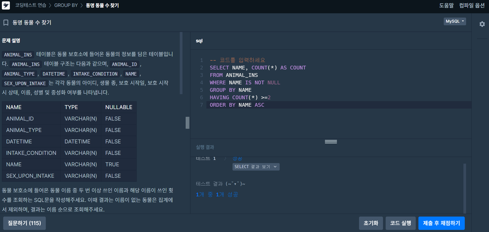
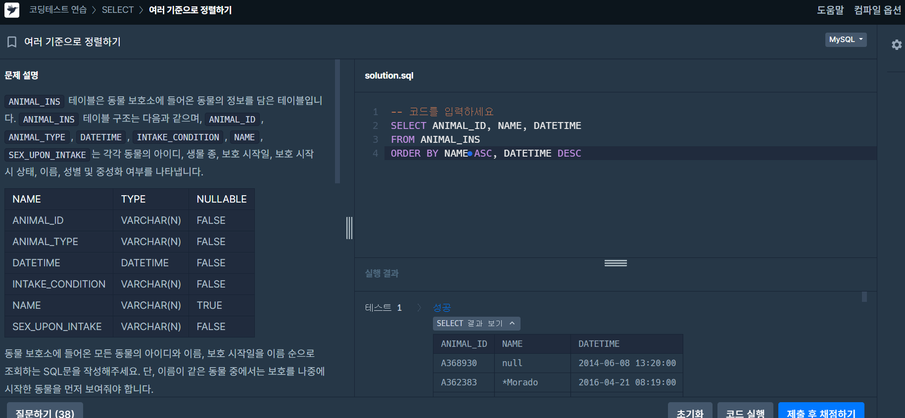

# 📘 SQL_BASIC 7주차 정규 과제

이번 주 필수 강의는 없습니다.

이번 주는 지금까지 배운 SQL 내용을 가볍게 복습하는 것으로 마무리합니다. 문제 풀이보다 중요한 것은 **내가 어떤 SQL 개념을 익혔고, 아직 어떤 부분이 헷갈리는지 정리하는 것**입니다.

완성된 과제는 Github에 업로드하고, 링크를 스프레드시트 'SQL' 시트에 입력해 제출해주세요.

**👀 수행 인증란은 필수입니다.**

---

## 📚 SQL_BASIC_7th_REVIEW

---

## ✨ 선택 강의

- 6-2. 가독성을 챙기기 위한 SQL 스타일 가이드: SQL을 더 읽기 좋게 작성하고 싶을 때 선택 수강
- 6-3. 가독성을 챙기기 위한 WITH 문 & 파티션: WITH 문과 파티션 개념을 가볍게 살펴보고 싶을 때 선택 수강
- 6-4. 데이터 결과 검증 정의: 쿼리 결과를 검증하는 관점을 알고 싶을 때 선택 수강
- 6-5. 데이터 결과 검증 예시: 결과 검증 사례를 확인하고 싶을 때 선택 수강

---

## 🏁 전체 강의 수강 계획

| 주차 | 필수 강의 범위 | 선택 강의 | 완료 여부 |
| --- | --- | --- | --- |
| 1주차 | 1-1 ~ 2-1 | 1 | ✅ |
| 2주차 | 2-2 ~ 2-3 | 2-4 | ✅ |
| 3주차 | 2-5, 2-7 ~ 2-8 | 2-6 | ✅ |
| 4주차 | 3-2 ~ 4-3 | 3-4 | ✅ |
| 5주차 | 4-4 ~ 4-6 | 4-5, 4-7 | ✅ |
| 6주차 | 5-2 ~ 5-5 | 5-6 | ✅ |
| 7주차 | 필수 강의 없음 | 6-2, 6-3, 6-4, 6-5 | ✅ |

---

<br>

<!-- 여기까진 그대로 둬 주세요-->

---

## 🔁 복습할 개념

- SELECT, FROM, WHERE
- ORDER BY, LIMIT
- GROUP BY, HAVING
- COUNT, SUM, AVG, MAX, MIN
- 문자열 함수
- 날짜/시간 함수
- CASE WHEN
- JOIN

---

# 1️⃣ 전체 개념 복습

아래 키워드 중 중요하다고 생각한 개념을 2개 이상 골라 짧게 정리해주세요. 3개보다 더 많이 정리하고 싶다면 자유롭게 항목을 추가해도 좋습니다.

복습 키워드:
- SELECT
- WHERE
- GROUP BY
- HAVING
- 문자열 함수
- 날짜/시간 함수
- CASE WHEN
- JOIN

## 01. GROUP BY / HAVING

```
개념 이름: GROUP BY / HAVING

개념 설명:
- GROUP BY: 특정 컬럼을 기준으로 데이터를 그룹화하여 집계할 때 사용
- HAVING: 그룹화된 결과에 조건을 적용할 때 사용
- WHERE는 그룹화 이전의 개별 행을 필터링하고, HAVING은 그룹화 이후의 집계 결과를 필터링함
예시 쿼리:
SELECT CATEGORY, COUNT(*) AS PRODUCT_COUNT
FROM PRODUCT
GROUP BY CATEGORY
HAVING COUNT(*) >= 5;


→ 카테고리별 상품 수를 계산하고, 상품이 5개 이상인 카테고리만 조회
```

## 02. JOIN

```
개념 이름: JOIN

개념 설명:
- 두 개 이상의 테이블을 공통된 컬럼(JOIN KEY)을 기준으로 결합할 때 사용
- INNER JOIN: 양쪽 테이블에서 JOIN 조건이 일치하는 데이터만 반환
- LEFT JOIN: 왼쪽 테이블의 모든 데이터를 유지하고, 오른쪽 테이블에 일치하는 데이터가 없으면 NULL 반환
예시 쿼리:
SELECT A.AUTHOR_NAME, B.BOOK_NAME
FROM BOOK B
INNER JOIN AUTHOR A
    ON B.AUTHOR_ID = A.AUTHOR_ID;


→ BOOK과 AUTHOR 테이블을 AUTHOR_ID로 연결하여 도서명과 저자명을 조회
```

## (선택) 03. CASE WHEN

```
개념 이름: CASE WHEN

개념 설명:
- 조건에 따라 서로 다른 값을 반환하는 조건문
- WHEN으로 조건을 지정하고, THEN으로 결과를 설정
- ELSE는 모든 조건에 해당하지 않을 때 반환할 값을 지정
예시 쿼리:
SELECT PRODUCT_NAME,
       PRICE,
       CASE
           WHEN PRICE >= 100000 THEN '고가'
           WHEN PRICE >= 50000 THEN '중가'
           ELSE '저가'
       END AS PRICE_LEVEL
FROM PRODUCT;


→ 상품 가격에 따라 고가, 중가, 저가로 분류하여 조회
```
## 04. 날짜/시간 함수
개념 이름: 날짜/시간 함수

개념 설명:
- 날짜 데이터에서 연도, 월, 일 등 특정 정보를 추출하거나 날짜 형식을 변환할 때 사용
- YEAR(), MONTH(), DAY(): 날짜에서 연도, 월, 일을 추출
- DATE_FORMAT(): 날짜를 원하는 형식의 문자열로 변환
예시 쿼리:
SELECT ANIMAL_ID,
       NAME,
       DATE_FORMAT(DATETIME, '%Y-%m-%d') AS DATE
FROM ANIMAL_INS
ORDER BY ANIMAL_ID;


→ 동물 보호소에 들어온 동물의 보호 시작일을 YYYY-MM-DD 형식으로 변환하고, 동물 ID를 기준으로 오름차순 정렬하여 조회
---

# 2️⃣ 수행 인증란

아래 중 하나 이상을 첨부해주세요.

- 복습 문제 정답 화면 캡처
- SQL 실행 결과 화면 캡처
- 전체 개념 정리 노트 캡처


---

# 3️⃣ 복습 문제

프로그래머스는 로그인이 필요하므로, 로그인 후 문제 풀이를 진행해주세요.

## 🧩 문제 1

문제 링크: [여러 기준으로 정렬하기](https://school.programmers.co.kr/learn/courses/30/lessons/59404)

풀이 과정:

```
SQL 코드:
SELECT ANIMAL_ID, NAME, DATETIME
FROM ANIMAL_INS
ORDER BY NAME ASC, DATETIME DESC;


풀이 과정
- 문제 요구사항: 모든 동물의 아이디, 이름, 보호 시작일을 조회
- 첫 번째 정렬 기준: NAME ASC → 이름을 사전순으로 오름차순 정렬
- 두 번째 정렬 기준: DATETIME DESC → 이름이 같은 경우 보호 시작일이 늦은 동물부터 정렬
- 복습한 점: ORDER BY에 여러 컬럼을 지정하면 앞의 컬럼부터 우선 정렬하며, 각 컬럼에 ASC와 DESC를 개별적으로 적용할 수 있음
```



## 🧩 문제 2

문제 링크: [동명 동물 수 찾기](https://school.programmers.co.kr/learn/courses/30/lessons/59041)

풀이 과정:

```
- 그룹화 기준:
  GROUP BY NAME → 이름별로 데이터 그룹화
- 제외해야 하는 값: 
  WHERE 조건- NAME IS NOT NULL → 이름이 없는 동물 제외
- HAVING 조건:
  COUNT(*) >= 2 → 같은 이름이 2번 이상 등장한 경우만 조회
- 복습한 점:
  WHERE는 그룹화 이전에 개별 데이터를 필터링하고, HAVING은 GROUP BY로 집계한 결과에 조건을 적용한다는 차이를 복습함.
```


---

# 4️⃣ 최종 회고

7주 동안 SQL BASIC 과제를 진행하며 느낀 점을 자유롭게 작성해주세요.

```
1. SQL을 배우기 전과 비교했을 때 달라진 점:  
SQL을 배우기 전에는 데이터를 조회하고 가공하는 과정이 익숙하지 않았지만, 7주 동안 과제를 진행하면서 필요한 데이터를 조건에 맞게 추출하고 정렬하거나 집계하는 방법을 익힐 수 있었습니다.

2. 가장 도움이 되었던 과제 또는 문제 유형:  
JOIN을 활용해 여러 테이블을 결합하는 문제가 가장 도움이 되었습니다. 실제 데이터 분석에서도 여러 테이블을 연결해야 하는 경우가 많기 때문에 실용적인 개념이라고 느꼈습니다.

3. 가장 어려웠던 개념: 
GROUP BY와 HAVING의 차이, JOIN에서 테이블 간 연결 관계를 파악하는 과정이 어려웠습니다. 특히 여러 조건을 함께 적용할 때 쿼리의 실행 순서를 이해하는 데 시간이 필요했습니다.

4. 앞으로 데이터 분석이나 프로젝트에서 SQL을 어떻게 활용해보고 싶은지:
금융 및 비즈니스 데이터 분석 프로젝트에서 SQL을 활용해 대규모 데이터를 추출하고 전처리해 보고 싶습니다. 특히 Python과 SQL을 함께 사용하여 데이터 수집부터 분석까지 효율적으로 진행해 보고 싶습니다.

5. SQL BASIC 과제에 대한 피드백:
기초 개념부터 단계적으로 학습하고 프로그래머스 문제를 통해 직접 적용해 볼 수 있어서 좋았습니다. 매주 배운 내용을 복습하며 실습할 수 있었고, SQL에 대한 자신감을 높이는 데 도움이 되었습니다.
```

정말 수고하셨습니다!


